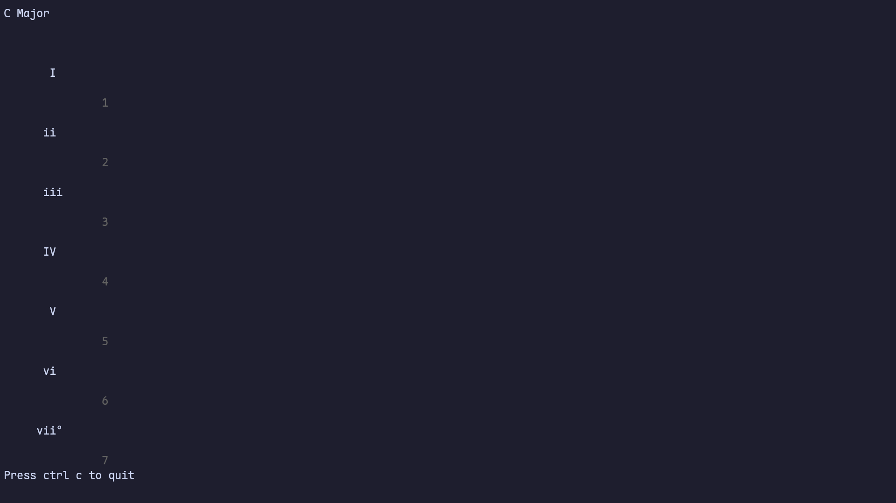

# TUI Chord Player

Written in go
To facilitate TUI music enjoyers in getting harmonic ideas out easily.

## Instructions

Currently just dev setup to run from source

```
git clone https://github.com/tango8/tui-musical-chord-player.git
cd tui-musical-chord-player

go mod tidy

go run .
```

## Examples



## Citations

<https://charm.land/bubbletea/v2> v2.0.2 (MIT License)
<https://github.com/ebitengine/oto/v3> v3.2.0 (Apache-2.0 License)
<https://github.com/hajimehoshi/go-mp3> v0.3.4 (Apache-2.0 License)

default piano sound - <https://www.polyphone.io/en/soundfonts/instrument-sets/640-gm-sf2>

### future functionalities

adding user custom sounds(asks user for the sound and its key)
holding(ending sound if another input isn't entered after a certain time)
